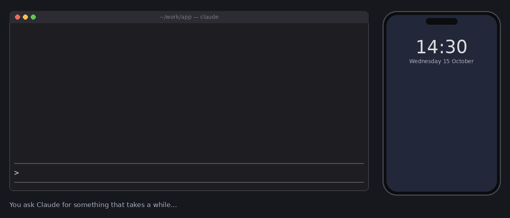

# clawd-notify

Go do something else while Claude works. [Claude Code](https://claude.com/claude-code) tells you when it's **done**, when it **needs your approval**, and, if you like, when it's **waiting for you**. You get a desktop notification, a chime, and optionally a push to your phone.



- **Done:** only for turns that ran a while (30 s by default), so quick answers you watched don't ping you. The notification shows the first line of Claude's answer and how long it took. A turn you stopped with Esc, or a subagent finishing, stays quiet.
- **Needs approval:** a permission dialog is waiting. This one also pushes to your phone, at high priority.
- **Waiting for input** (off by default): Claude has been sitting at the prompt for a while.
- **Two chimes,** one for "done" and one for "needs you", so you can tell them apart without looking.

## Install

In Claude Code, type:

```
/plugin install clawd-notify --marketplace itsomidho/claude-plugins
```

Then run `/notify test` to try every channel.

## Settings

Under `/config` → clawd-notify:

| Setting | Default | |
|---|---|---|
| Only turns longer than (seconds) | 30 | The shortest turn that notifies "done" |
| When Claude needs approval | on | |
| When Claude waits for input | off | |
| Desktop notification | auto | `auto`: your terminal's notifications (iTerm2, kitty, Ghostty), or the system's where it has none (`notify-send` on Linux, `osascript` on macOS). `terminal`, `system` or `off` to pick one |
| Sound | chime | `none` to turn it off. Played with `afplay` on macOS and `paplay`, `pw-play` or `aplay` on Linux |
| Phone push URL | (none) | An [ntfy](https://ntfy.sh) topic URL, stored in your local `settings.json` |
| Phone: only turns longer than (seconds) | 120 | Approval requests always push |

### Your phone

1. Install the ntfy app ([Android](https://play.google.com/store/apps/details?id=io.heckel.ntfy), [iOS](https://apps.apple.com/app/ntfy/id1625396347)).
2. Subscribe to a topic with a long, random name. Anyone who knows the name can read it, so treat it like a password: `claude-7f3k9q2m8x`, not `claude`.
3. Set the phone push URL to `https://ntfy.sh/claude-7f3k9q2m8x` (or your own ntfy server), then run `/notify test`.

## Commands

- `/notify`: the settings in effect, how many notifications were sent this session, and the last one
- `/notify test`: sends a test through every channel and says which ones worked, why any failed, and whether your desktop is hiding notifications (see below)
- `/notify off` / `/notify on`: mute for this session (handy in a meeting)

## Good to know

- **No double notifications.** Claude Code already sends its own "needs permission" notification through terminals that support it. clawd-notify then adds only the sound and the phone push. It adds a system notification only where your terminal has no notification channel.
- **No sound on Linux?** Install `pulseaudio-utils` (for `paplay`) or `pipewire-bin` (for `pw-play`).
- **No desktop notification on Linux?** clawd-notify tries `notify-send`, then talks to the notification service directly with `gdbus`. The second route still works where `notify-send` breaks, such as inside an AppImage terminal that ships an older libnotify. `/notify test` says why each channel failed.
- **Sent but not shown?** A notification can be delivered and still never appear: Do Not Disturb, Focus, or banners turned off in your desktop's settings. `/notify test` checks for this and names the switch:
  - **Linux:** GNOME, Cinnamon, MATE and Xfce settings; KDE Plasma and any server with the standard Do Not Disturb flag; dunst, mako and SwayNC; and no notification service running at all.
  - **macOS:** an active Focus mode. Notifications sent with `osascript` appear as "Script Editor", which macOS can mute separately.
  - **Windows:** clawd-notify notifies only through your terminal there, and can't read Focus Assist, so the test just reminds you to check it.
- **Notifications are sent after the turn ends.** A slow network never holds up Claude.
- **Organization-managed Claude Code:** the approval and waiting-for-input notifications come from Claude Code's notification event. Where an organization manages Claude Code, that event only reaches plugins the organization lists. "Done" notifications work everywhere.

## License

MIT. The chimes are made by `docs/make_sounds.py`.
